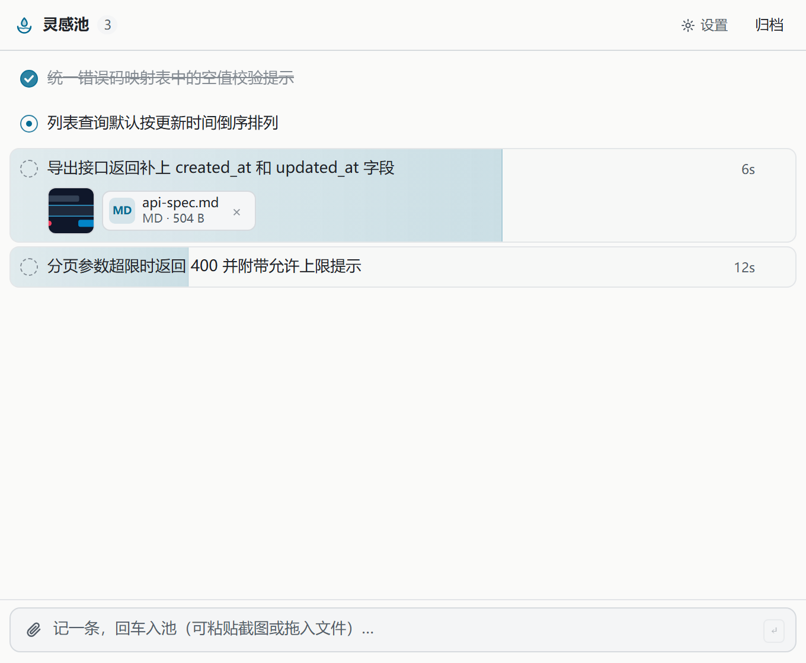
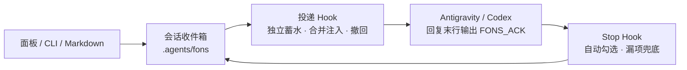

<p align="center">
  
</p>

<h1 align="center">Fons · 灵感池</h1>

<p align="center">
  <strong>面向 Antigravity 与 Codex 的会话级旁路灵感蓄水池</strong><br>
  边看 AI 写代码边随手记下补充想法——不憋着忘掉，也不中途插话打断模型心流。
</p>

---

## 解决什么问题

当 AI 正在跨文件修改代码时，脑子里常会顺带冒出一些**不紧急但不想漏掉**的补充：

- “导出接口顺便补上 `created_at` 字段”
- “分页超限时返回 400 并给上限提示”
- “改完记得补一组权限单测”

直接发聊天消息容易打断当前上下文节奏，忍着等这轮结束又容易忘。**Fons 把“随时记录”和“合适时机投递”拆开：**

- **非紧急补充 → 丢进灵感池**：每条灵感独立蓄水缓冲（默认 `45s`），期间随时改写或删掉；到期后在下一次可投递的 Hook 合并注入，本轮收尾时也会自动兜底。
- **紧急叫停 / 立刻纠偏 → 照旧用聊天框或停止按钮**。

## 能干什么

- **单条独立蓄水消抖**：每条灵感各自计时涨水位，新增条目不会重置旧草稿；点击编辑某条时仅暂缓该条自身计时，保存后重新蓄水。
- **三态清晰、支持撤回与归档**：待投递（可编辑）→ 已投递（文本锁定，删除时向模型发撤回通知）→ 已完成（一键归档收拢）。
- **无感自动勾选，零额外工具轮次**：模型处理完后只需在回复末行输出 `[FONS_ACK: 编号]`，由 `Stop` Hook 自动回写 `【√】 ` 前缀；读写模式与只读 Plan 模式均可闭环。
- **支持截图与参考文件附件**：面板支持拖拽文件、`Ctrl+V` 粘贴截图或点击附件按钮添加图片/文档（展示缩略预览图与文件块，点击小图可放大预览，单文件上限 `10 MB`、单条最多 `8` 个），自动存入会话附件仓并在投递时随条目提供本地路径。
- **双宿主原生面板与多入口互通**：Antigravity 侧栏面板（Sidecar）、Codex 原生侧栏面板（MCP Apps）、终端 CLI（`fons`）、直接编辑 Markdown 收件箱四种方式同步互通。
- **按会话严格隔离**：支持项目工作区会话与无工作区（无项目）会话，每个会话拥有独立收件箱、附件仓、状态账本与归档，多任务并行互不干扰。

## 实机截图

<table>
  <tr>
    <td align="center" width="50%">
      <br>
      <sub>深色主题 · <code>↑ 水位</code> 自下而上（含蓄水中 / 编辑暂缓 / 已投递 / 已完成）</sub>
    </td>
    <td align="center" width="50%">
      <br>
      <sub>浅色主题 · <code>→ 水位</code> 自左向右水位推进</sub>
    </td>
  </tr>
</table>

> 状态圆点说明：虚线圆圈 = **待投递（蓄水中）**，点击可直接标为完成；实心点圆圈 = **已投递（Hook 已发出，等待回执）**；蓝底对勾 = **已完成**，点击可重新打开。

## 工作原理与架构



Fons 将收件箱解析、状态账本与单条蓄水引擎与具体宿主解耦，通过宿主适配层映射不同生命周期钩子：

- **Antigravity（`adapters/antigravity.mjs`）**
  - `SessionStart`：登记当前会话与工作区（或无工作区作用域）绑定关系；空箱时启动脚本自动短路，零额外开销。
  - `PreInvocation`：将蓄水到期条目与待发撤回合并注入下一次模型调用；无工作区会话仅在首次投递时附带极简回执提示，并将无工作区附件按需镜像至会话 `artifactDir/fons-attachments/` 供沙箱读取。
  - `Stop`：读取 `transcript.jsonl` 本轮回复末行的 `[FONS_ACK: ...]` 并自动回写 `【√】 `；若有漏处理或本轮末未处于编辑暂缓的待投递条目，自动兜底续跑（最多 2 次）。
- **Codex（`adapters/codex.mjs`）**
  - `SessionStart`：登记主线程并绑定 rollout 日志锚点，自动忽略子代理（Subagent）会话。
  - `UserPromptSubmit` / `PostToolUse`：在用户提交提示与工具执行完成后，将蓄水到期条目与待发撤回作为附加上下文合并注入。
  - `Stop`：增量扫描主线程最终答复（`final_answer`）末行的 `[FONS_ACK: ...]` 自动勾选；对未确认或未处于编辑暂缓的条目自动兜底续跑（最多 2 次，设置 `FONS_STOP_WAIT_DEBOUNCE=1` 可让 `Stop` 也遵守蓄水期）。

有工作区会话的数据存放在目标工作区的 `.agents/fons/` 下，无工作区（无项目）会话存放在对应宿主数据目录 `<appData>/fons/no-workspace/` 下（附件按会话隔离在同级 `attachments/<sessionId>/` 中），均可直接在编辑器中按行编辑 `ideas-<sessionId>.md`（空行与 `#` 注释自动忽略）：

```markdown
# 本轮补充灵感
- [ ] 导出接口补充 created_at 字段
- [ ] 窄屏下按钮错位 [ui-bug.png](attachments/<sessionId>/ui-bug-a1b2c3d4.png)
【√】 统一错误码映射表中的空值校验提示
```

## Antigravity 快速开始

### 1. 安装与挂载（Windows）

推荐**在目标工作区挂载插件本体（工作区 Hook + Rules）**，并**将全局包 `ui-plugin` 挂到全局 `plugins` 目录**——侧边栏标签页会自动显示专属水珠图标，并附带仅作用于无工作区会话的 Hook（不会干预或污染任何项目工作区）。

将示例中的 `F:\Fons` 替换为实际仓库路径，在目标工作区执行：

```powershell
# 1) 在当前项目挂载 Fons（工作区 Hook + Rules）
New-Item -ItemType Directory -Force .agents\plugins | Out-Null
cmd /c mklink /J .agents\plugins\fons F:\Fons

# 2) 从旧版迁移：移除旧独立 sidecars\fons-pool 与旧全局 plugins\fons，避免菜单重复或旧全局 Hook 干扰普通项目
$oldSidecar = Join-Path $env:USERPROFILE '.gemini\config\sidecars\fons-pool'
if (Test-Path -LiteralPath $oldSidecar) { cmd /c rmdir "$oldSidecar" }
$pluginsDir = Join-Path $env:USERPROFILE '.gemini\config\plugins'
$oldGlobalPlugin = Join-Path $pluginsDir 'fons'
if (Test-Path -LiteralPath $oldGlobalPlugin) {
  if ((Get-Item -LiteralPath $oldGlobalPlugin).Attributes -band [IO.FileAttributes]::ReparsePoint) {
    cmd /c rmdir "$oldGlobalPlugin"
  } else {
    Remove-Item -LiteralPath $oldGlobalPlugin -Recurse -Force
  }
}

# 3) 全局安装 UI 面板 + 无工作区 Hook（真实目录 + fons-root.json 指向仓库；Windows 下 plugins 目录不识别 Junction）
New-Item -ItemType Directory -Force $pluginsDir | Out-Null
$globalUiPlugin = Join-Path $pluginsDir 'fons-pool'
if (Test-Path -LiteralPath $globalUiPlugin) {
  if ((Get-Item -LiteralPath $globalUiPlugin).Attributes -band [IO.FileAttributes]::ReparsePoint) {
    cmd /c rmdir "$globalUiPlugin"
  } else {
    Remove-Item -LiteralPath $globalUiPlugin -Recurse -Force
  }
}
Copy-Item -LiteralPath 'F:\Fons\ui-plugin' -Destination $globalUiPlugin -Recurse -Force
@{ root = 'F:\Fons' } | ConvertTo-Json | Set-Content -LiteralPath (Join-Path $globalUiPlugin 'fons-root.json') -Encoding utf8
```

> **注意**：请勿把仓库根目录 `F:\Fons` 直接放到 `~/.gemini/config/plugins/`，否则根目录工作区 `hooks.json` 会在所有工作区生效或与工作区挂载重复执行；全局 `fons-pool` 需以真实目录形式安装并通过 `fons-root.json` 指向本地仓库（Windows 下 Antigravity 插件扫描会跳过 `~/.gemini/config/plugins/` 中的 Junction）。旧版若曾全局安装 `plugins\fons`，请按上述步骤 2 移除后重启 Antigravity 并新开无工作区会话。
>
> **Unix / macOS**：全局 `ui-plugin/hooks.json` 直接调用 `node scripts/bootstrap-hook.mjs`，无需修改；工作区挂载需为 `scripts/run-hook.sh` 和 `bin/fons` 赋予执行权限，并将根目录 `hooks.json` 中三个事件的命令改为 `./scripts/run-hook.sh SessionStart|PreInvocation|Stop`。

### 2. 打开  灵感池面板

在 Antigravity 会话右侧点击 **+ → Extensions → 灵感池**：

- 底部速记框按 **Enter** 入池，支持 `Ctrl+V` 粘贴截图、拖拽文件入池（拖到待投递行可直接挂载到该行，也支持纯附件无文字直接入池），粘贴多行纯文本自动按非空行拆分，中文输入法选词时不误提交；
- 顶栏可一键切换 **「↑ 水位 / → 水位」** 蓄水方向，或点击 **「归档」** 收拢已完成条目；
- 面板自动绑定当前会话（支持已挂载 Fons 的项目工作区会话，以及启用全局 `fons-pool` 后的无工作区会话）。

## Codex 快速开始

### 1. 准备与安装插件

在运行 Codex 的宿主环境（Windows、WSL2 或远端）中确保 `node` 已在 `PATH` 上，先运行 `fons codex init`（或 `bin\fons.cmd codex init`）生成本地插件包，再按终端输出的路径注册并安装：

```powershell
fons codex init
codex plugin marketplace add "<fons codex init 输出的插件市场目录>"
codex plugin add fons@fons-local
```

- **信任 Hook**：启动新的 Codex 会话，在桌面设置 **Hooks** 页面或 CLI `/hooks` 中审阅并信任 Fons 的 Hook。插件包由 Codex 从本地市场复制管理，内置会话 Hook 与本地 MCP 服务，无需启动本地端口或打开浏览器。
- **后续更新**：更新 Fons 仓库后，重新执行 `fons codex init` 与安装命令并按提示审阅变更即可。
- **单一注册来源**：请仅保留插件这一处 Fons Hook 注册来源（若曾在用户层 `~/.codex/hooks.json` 或项目层 `.codex/hooks.json` 直接配置过 Fons Hook，`fons codex init` 会提示先清理冲突项）。命令不会改动原有其他 Hook 与 `AGENTS.md`；如需手动补充静态规则，可参考 [Codex 回执约定](codex/AGENTS.snippet.md)。

### 2. 打开  灵感池面板

请先信任 Hook 并新开会话（面板通过 Codex 会话身份安全绑定当前已登记会话，切换会话后在目标会话重新打开即可）：

- **从右侧标签栏直接打开（推荐）**：在目标会话右侧新建标签页，展开 **Open** 菜单并选择 **灵感池**（点击旁边的 📌 可固定入口），无需输入或发送消息即可直接打开；
- **从输入框唤起**：在输入框键入 `@`，选中 **Fons · 灵感池**，发送默认提示词「打开当前会话的 Fons 灵感池」；
- 面板自动跟随 Codex 深浅色主题，完整支持速记、行内编辑、水位方向切换、归档、粘贴截图、拖拽与选取附件；无 MCP Apps 界面的纯 CLI 客户端可直接使用下方 `fons` 命令。

## CLI 与常用配置

将 `bin/` 加入 `PATH`（Windows 下也可直接运行 `bin\fons.cmd`），在目标工作区或其子目录下使用（无工作区会话使用 `-n` / `--no-workspace` 或 `-s <sessionId>`）：

```powershell
fons "导出接口补充 created_at 字段"               # 添加一条灵感
fons -a ./ui-bug.png "窄屏下按钮错位"             # 添加带截图/文件附件的灵感（支持多个 -a / --attach）
fons list                                         # 查看未完成条目与确认令牌
fons done <token1> [token2...]                    # 手动标记完成
fons archive                                      # 归档已完成条目
fons sessions                                     # 列出当前作用域的已登记会话
fons -s <sessionId> list                          # 多会话并存时显式指定会话 UUID
fons --host codex "补一组权限测试"                # 限定查找或操作 Codex 会话（支持 codex / antigravity）
fons -n "无工作区补充"                            # 操作无工作区会话（完整写法 --no-workspace）
fons codex init                                   # 生成/更新 Codex 本地插件市场包
```

| 环境变量 | 默认值 | 说明 |
| --- | --- | --- |
| `FONS_DEBOUNCE_SEC` | `45` | 每条待投递灵感的独立蓄水秒数，`0` 表示不等待 |
| `FONS_STOP_WAIT_DEBOUNCE` | 未设置 | 设为 `1` 时，Codex 的 `Stop` Hook 也遵守蓄水期而不提前兜底 |
| `FONS_SESSION` | 未设置 | 指定已登记的会话 UUID（命令行 `-s` / `--session` / `-n` 优先） |
| `FONS_ROOT` | 向上自动查找 | 未指定会话时用于显式指定工作区根目录 |
| `FONS_HOST` | 自动发现 | 用 `codex` 或 `antigravity` 限定宿主（命令行 `--host` 优先） |
| `FONS_APP_DATA` | Antigravity 为 `~/.gemini/antigravity`<br>Codex 为 `CODEX_HOME` 或 `~/.codex` | 覆盖宿主会话数据目录（会话索引在 `fons/conversations`，无工作区数据在 `fons/no-workspace`） |

## 注意事项

- **投递时机**：消抖到期后在下一次可投递的 Hook（Antigravity 的 `PreInvocation`，Codex 的 `UserPromptSubmit` / `PostToolUse`）合并注入，不会主动唤醒空闲会话；纯文本长回复或单次长耗时工具执行期间会推迟到下一处 Hook，本轮结束时 `Stop` Hook 会兜底未处于编辑暂缓中的条目，撤回通知按尽力送达处理。
- **并发与外部编辑**：面板、CLI 与 Hook 对同一会话的写入会自动加锁串行化；在外部编辑器直接修改 `ideas-<sessionId>.md` 时请避开并发写入。
- **附件生命周期与沙箱权限**：缓冲期删除条目或移除单个附件时会自动清理无引用的孤立附件，归档时保留原附件并将链接重写为 `../attachments/...`；宿主中删除会话后对应目录可按需手动清理。Codex 下附件以宿主原生绝对路径提供，无项目会话附件位于 Codex 数据目录（沙箱外），可能需要单独授权读取；跨 Windows、WSL2 或远端环境时请保持 Codex、Hook 与 CLI 运行在同一文件系统环境以确保路径可达。

## 测试与演进

项目使用 Node 内置测试运行器，零外部依赖：

```sh
node --test
```

后续规划（Claude Code 适配等）见 [ROADMAP.md](ROADMAP.md)。
