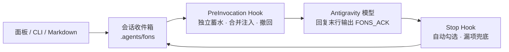

<p align="center">
  
</p>

<h1 align="center">Fons · 灵感池</h1>

<p align="center">
  <strong>面向 Antigravity 的会话级旁路灵感蓄水池</strong><br>
  边看 AI 写代码边随手记下补充想法——不憋着忘掉，也不中途插话打断模型心流。
</p>

---

## 解决什么问题

当 AI 正在跨文件修改代码时，脑子里常会顺带冒出一些**不紧急但不想漏掉**的补充：

- “导出接口顺便补上 `created_at` 字段”
- “分页超限时返回 400 并给上限提示”
- “改完记得补一组权限单测”

直接发聊天消息容易打断当前上下文节奏，忍着等这轮结束又容易忘。**Fons 把“随时记录”和“合适时机投递”拆开：**

- **非紧急补充 → 丢进灵感池**：每条灵感独立蓄水缓冲（默认 `45s`），期间随时改写或删掉；到期后在下一次模型调用时静默合并注入，本轮收尾前也会自动兜底。
- **紧急叫停 / 立刻纠偏 → 照旧用聊天框或停止按钮**。

## 能干什么

- **单条独立蓄水消抖**：每条灵感各自计时涨水位，新增条目不会重置旧草稿；点击编辑某条时仅暂缓该条自身计时，保存后重新蓄水。
- **三态清晰、支持撤回与归档**：待投递（可编辑）→ 已投递（文本锁定，删除时向模型发撤回通知）→ 已完成（一键归档收拢）。
- **无感自动勾选，零额外工具轮次**：模型处理完后只需在回复末行输出 `[FONS_ACK: 编号]`，由 `Stop` Hook 自动回写 `【√】 ` 前缀；读写模式与只读 Plan 模式均可闭环。
- **多入口互通**：侧栏「灵感池」面板、终端 CLI（`fons`）、直接编辑 Markdown 收件箱三种方式同步生效。
- **按会话隔离**：每个会话拥有独立收件箱、状态账本与归档，多任务并行互不干扰。

## 实机截图

<table>
  <tr>
    <td align="center" width="50%">
      <br>
      <sub>深色主题 · <code>↑ 水位</code> 自下而上（含蓄水中 / 编辑暂缓 / 已投递 / 已完成）</sub>
    </td>
    <td align="center" width="50%">
      <br>
      <sub>浅色主题 · <code>→ 水位</code> 自左向右水位推进</sub>
    </td>
  </tr>
</table>

> 状态圆点说明：虚线圆圈 = **待投递（蓄水中）**，点击可直接标为完成；实心点圆圈 = **已投递（模型已收到）**；蓝底对勾 = **已完成**，点击可重新打开。

## 工作原理与架构



- **`SessionStart`**：登记当前会话与工作区（或无工作区作用域）的绑定关系；空箱时启动脚本自动短路，无额外开销。
- **`PreInvocation`**：将蓄水到期的条目和待发撤回合并注入下一次模型调用；无工作区会话仅在首次投递时附带极简 `[FONS_ACK: 编号]` 回执提示，后续投递只留 `[FONS]` 与真实条目。
- **`Stop`**：读取模型回复末行的 `[FONS_ACK: ...]` 并自动回写 `【√】 `；若有漏处理或本轮末未暂缓的待投递条目，自动兜底续跑（最多 2 次）。

有工作区会话的数据存放在目标工作区的 `.agents/fons/` 下，无工作区会话（No Project）存放在宿主数据目录 `<appData>/fons/no-workspace/` 下，均可直接在编辑器中按行编辑 `ideas-<conversationId>.md`（空行与 `#` 注释自动忽略）：

```markdown
# 本轮补充灵感
导出接口补充 created_at 字段
【√】 统一错误码映射表中的空值校验提示
```

## 快速开始

### 1. 安装与挂载（Windows）

推荐**在目标工作区挂载插件本体（工作区 Hook + Rules）**，并**将全局包 `ui-plugin` 挂到全局 `plugins` 目录**——侧边栏标签页会自动显示专属水珠图标，并附带仅作用于无工作区会话的 Hook（不会干预或污染任何项目工作区）。

将示例中的 `F:\Fons` 替换为实际仓库路径，在目标工作区执行：

```powershell
# 1) 在当前项目挂载 Fons（工作区 Hook + Rules）
New-Item -ItemType Directory -Force .agents\plugins | Out-Null
cmd /c mklink /J .agents\plugins\fons F:\Fons

# 2) 从旧版迁移：移除旧独立 sidecars\fons-pool 与旧全局 plugins\fons，避免菜单重复或旧全局 Hook 干扰普通项目
$oldSidecar = Join-Path $env:USERPROFILE '.gemini\config\sidecars\fons-pool'
if (Test-Path -LiteralPath $oldSidecar) { cmd /c rmdir "$oldSidecar" }
$pluginsDir = Join-Path $env:USERPROFILE '.gemini\config\plugins'
$oldGlobalPlugin = Join-Path $pluginsDir 'fons'
if (Test-Path -LiteralPath $oldGlobalPlugin) {
  if ((Get-Item -LiteralPath $oldGlobalPlugin).Attributes -band [IO.FileAttributes]::ReparsePoint) {
    cmd /c rmdir "$oldGlobalPlugin"
  } else {
    Remove-Item -LiteralPath $oldGlobalPlugin -Recurse -Force
  }
}

# 3) 全局安装 UI 面板 + 无工作区 Hook（真实目录 + fons-root.json 指向仓库；Windows 下 plugins 目录不识别 Junction）
New-Item -ItemType Directory -Force $pluginsDir | Out-Null
$globalUiPlugin = Join-Path $pluginsDir 'fons-pool'
if (Test-Path -LiteralPath $globalUiPlugin) {
  if ((Get-Item -LiteralPath $globalUiPlugin).Attributes -band [IO.FileAttributes]::ReparsePoint) {
    cmd /c rmdir "$globalUiPlugin"
  } else {
    Remove-Item -LiteralPath $globalUiPlugin -Recurse -Force
  }
}
Copy-Item -LiteralPath 'F:\Fons\ui-plugin' -Destination $globalUiPlugin -Recurse -Force
@{ root = 'F:\Fons' } | ConvertTo-Json | Set-Content -LiteralPath (Join-Path $globalUiPlugin 'fons-root.json') -Encoding utf8
```

> **注意**：请勿把仓库根目录 `F:\Fons` 直接放到 `~/.gemini/config/plugins/`，否则根目录工作区 `hooks.json` 会在所有工作区生效或与工作区挂载重复执行；全局 `fons-pool` 需以真实目录形式安装并通过 `fons-root.json` 指向本地仓库（Windows 下 Antigravity 插件扫描会跳过 `~/.gemini/config/plugins/` 中的 Junction）。旧版若曾全局安装 `plugins\fons`，请按上述步骤 2 移除后重启 Antigravity 并新开无工作区会话。
>
> **Unix / macOS**：全局 `ui-plugin/hooks.json` 直接调用 `node scripts/bootstrap-hook.mjs`，无需修改；工作区挂载需为 `scripts/run-hook.sh` 和 `bin/fons` 赋予执行权限，并将根目录 `hooks.json` 中三个事件的命令改为 `./scripts/run-hook.sh SessionStart|PreInvocation|Stop`。

### 2. 打开  灵感池面板

在 Antigravity 会话右侧点击 **+ → Extensions → 灵感池**：

- 底部速记框按 **Enter** 入池，粘贴多行自动按非空行拆分，中文输入法选词时不误提交；
- 顶栏可一键切换 **「↑ 水位 / → 水位」** 蓄水方向，或点击 **「归档」** 收拢已完成条目；
- 面板自动绑定当前会话（支持已挂载 Fons 的项目工作区会话，以及启用全局 `fons-pool` 后的无工作区会话）。

## CLI 与常用配置

将 `bin/` 加入 `PATH`（或直接运行 `bin\fons.cmd`），在目标工作区或其子目录下使用（无工作区会话使用 `-n` / `--no-workspace` 或 `-s <sessionId>`）：

```powershell
fons "导出接口补充 created_at 字段"   # 添加一条灵感
fons list                             # 查看未完成条目与确认令牌
fons done <token1> [token2...]        # 手动标记完成
fons archive                          # 归档已完成条目
fons -s <sessionId> list              # 多会话时显式指定会话 UUID
fons --no-workspace "无工作区补充"     # 操作无工作区会话（简写 -n）
```

| 环境变量 | 默认值 | 说明 |
| --- | --- | --- |
| `FONS_DEBOUNCE_SEC` | `45` | 每条待投递灵感的独立蓄水秒数，`0` 表示不等待 |
| `FONS_SESSION` | 未设置 | 指定已登记的会话 UUID（`-s` / `--session` / `-n` 优先） |
| `FONS_ROOT` | 向上自动查找 | 未指定会话时用于定位工作区 |
| `FONS_APP_DATA` | `~/.gemini/antigravity` | 宿主数据目录（索引在 `fons/conversations`，无工作区数据在 `fons/no-workspace`） |

## 注意事项

- 消抖到期在下一次模型调用时投递，不会主动唤醒空闲会话；本轮结束时 `Stop` Hook 会自动兜底未处于编辑暂缓中的条目。
- 面板、CLI 与 Hook 对同一会话的写入会自动串行化；在外部编辑器直接修改 `ideas-<id>.md` 时请避开并发写入。
- 宿主中删除会话后，对应 `ideas-<id>.md` 不会自动清理，可按需手动归档或删除。

<details>
<summary>旧版单文件收件箱迁移说明</summary>

检测到旧版 `.agents/fons/ideas.md` 时，Hook 会自动按会话拆分并保留旧副本（`archive/legacy.md`、`.state.legacy.json`）。若迁移意外中断导致 `.agents/fons/.migration.lock` 残留，请先停止该工作区的相关写入、备份整个 `.agents/fons` 目录，并核对锁目录下的 `owner.json` 与对应文件后再清理锁文件重试；已隔离的新会话收件箱不受影响。

</details>

## 测试与演进

项目使用 Node 内置测试运行器，零外部依赖：

```sh
node --test
```

后续规划（支持截图/文件附件、Codex 多宿主适配等）见 [ROADMAP.md](ROADMAP.md)。
