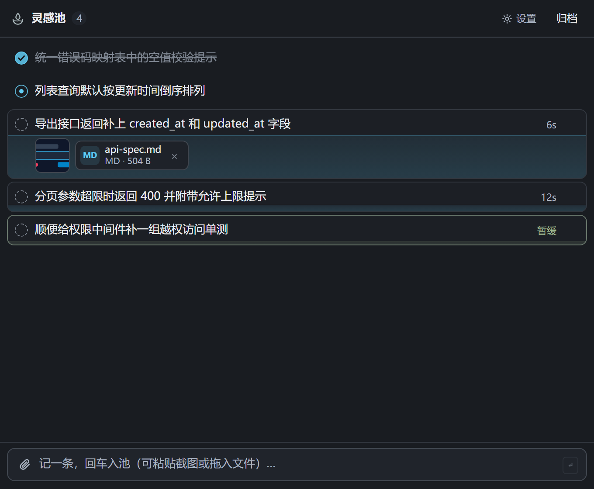
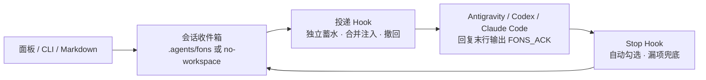

<p align="center">
  
</p>

<h1 align="center">Fons · 灵感池</h1>

<p align="center">
  <strong>面向 Antigravity、Codex 与 Claude Code 的会话级旁路灵感蓄水池</strong><br>
  边看 AI 写代码边随手记下补充想法——不憋着忘掉，也不中途插话打断模型心流。
</p>

<p align="center">
  <code>v0.4.0</code> · Node.js 零外部依赖 ·
  <a href="#多宿主支持一览">多宿主对比</a> ·
  <a href="#antigravity-快速开始">Antigravity</a> ·
  <a href="#codex-快速开始">Codex</a> ·
  <a href="#claude-code-快速开始">Claude Code</a> ·
  <a href="#通用本地-web-面板">Web 面板</a> ·
  <a href="#cli-与常用配置">CLI 与配置</a>
</p>

---

## 解决什么问题

当 AI 正在跨文件修改代码时，脑子里常会顺带冒出一些**不紧急但不想漏掉**的补充：

- “导出接口顺便补上 `created_at` 字段”
- “分页超限时返回 400 并给上限提示”
- “改完记得补一组权限单测”

直接发聊天消息容易打断当前上下文节奏，忍着等这轮结束又容易忘。**Fons 把“随时记录”和“合适时机投递”拆开：**

- **非紧急补充 → 丢进灵感池**：每条灵感独立蓄水缓冲（默认 `15s`），期间随时改写或删掉；到期后在下一次可投递的 Hook 合并注入，本轮收尾时也会自动兜底。
- **紧急叫停 / 立刻纠偏 → 照旧用聊天框或停止按钮**。

## 核心能力

- **单条独立蓄水消抖**：每条灵感各自计时涨水位，新增条目不会重置旧草稿；点击编辑某条时仅暂缓该条自身计时，保存后重新蓄水。
- **三态清晰、支持撤回与归档**：待投递（可编辑、可增删附件）→ 已投递（文本锁定，删除时向模型发撤回通知）→ 已完成（支持重开或一键归档收拢）。
- **无感自动勾选，零额外工具轮次**：模型处理完后只需在回复末行输出 `[FONS_ACK: 编号]`，由 `Stop` Hook 自动回写 `【√】 ` 前缀；读写模式与只读 Plan 模式均可闭环。
- **支持截图与参考文件附件**：支持拖拽文件、`Ctrl+V` 粘贴截图、点击附件按钮或 CLI `-a` 添加图片/文档（图片展示缩略预览并可点击灯箱放大，非图片展示文件块；单文件上限 `10 MB`、单条最多 `8` 个，支持纯附件入池），按会话落盘并在投递时向模型提供本地路径。
- **可视化设置与工作区管理**：在面板 **「设置」** 中可直接调整水位方向、蓄水消抖时长（`0`–`3600` 秒，支持设为 `0` 即时投递）、收尾兜底是否等待蓄水满，以及管理「所有工作区自动挂载」总开关、单工作区启停规则与未登记会话的一键登记（持久化于 `<appData>/fons/config.json`，环境变量可显式覆盖）。
- **多宿主与多入口同步互通**：Antigravity Sidecar 面板、Codex MCP Apps 原生侧栏、Claude Code 原生侧栏（`/fons`）、通用本地回环 Web 面板（`fons panel`）、终端 CLI（`fons`）以及直接编辑 Markdown 收件箱六种入口共享同一套会话账本。
- **按会话严格隔离**：支持项目工作区会话与无工作区（无项目）会话，每个会话拥有独立收件箱、附件仓、状态账本与归档，多任务并行互不干扰。

## 多宿主支持一览

| 维度 | [Antigravity](#antigravity-快速开始) | [Codex](#codex-快速开始) | [Claude Code](#claude-code-快速开始) |
| --- | --- | --- | --- |
| **安装方式** | 全局安装 `ui-plugin` 至 `plugins/fons-pool`（一次覆盖全部会话） | `fons codex init` → 注册本地插件市场并安装 | `fons claude init` → 注册本地插件市场并安装 |
| **原生面板** | 右侧扩展侧栏（Sidecar） | 右侧标签栏 **Open → 灵感池** / `@Fons · 灵感池`（MCP Apps） | 桌面端默认自动打开原生侧栏，`/fons` 随时开关 |
| **附件上传** | 原生面板（粘贴/拖拽/选文件）+ CLI `-a` | 原生面板（粘贴/拖拽/选文件）+ `fons panel` + CLI `-a` | 侧栏点 **「网页版」** / `/fons web`（`fons panel`）+ CLI `-a`（侧栏保留已有附件并显示数量） |
| **面板内设置** | 完整设置（水位、蓄水、收尾、工作区规则、一键登记） | 完整设置（水位、蓄水、收尾、工作区规则） | 侧栏内置常用设置（`0s`–`45s` 预设、收尾、当前工作区启停）；完整设置见「网页版」 |
| **生命周期 Hook** | `SessionStart` / `PreInvocation` / `Stop` | `SessionStart` / `UserPromptSubmit` / `PostToolUse` / `Stop` | `SessionStart` / `UserPromptSubmit` / `PostToolBatch` / `Stop` / `SessionEnd` |

## 实机截图

<table>
  <tr>
    <td align="center" width="50%">
      <br>
      <sub>深色主题 · 自下而上蓄水（含蓄水中 / 编辑暂缓 / 已投递 / 已完成）</sub>
    </td>
    <td align="center" width="50%">
      <br>
      <sub>浅色主题 · 自左向右水位推进</sub>
    </td>
  </tr>
</table>

> 状态圆点说明：虚线圆圈 = **待投递（蓄水中）**，点击可直接标为完成；实心点圆圈 = **已投递（已发出，等待回执）**；蓝底对勾 = **已完成**，点击可重新打开。  
> 注：截图用于展示水位与三态视觉效果；当前版本已将水位方向切换收纳至顶栏 **「设置」**，并在底部速记框新增了附件入口。

## 工作原理与架构



Fons 将收件箱解析（`scripts/fons-inbox.mjs`）、状态账本（`scripts/fons-store.mjs`）、配置管理（`scripts/fons-config.mjs`）与蓄水投递引擎（`scripts/fons-engine.mjs`）保持宿主无关，通过 `adapters/` 适配层映射各宿主生命周期：

- **Antigravity（`adapters/antigravity.mjs`）**
  - `SessionStart`：登记当前会话与工作区（或无工作区作用域）绑定关系；空会话零项目文件落盘，空箱时引导脚本短路退出，并遵循 `<appData>/fons/config.json` 中的自动挂载与工作区启停规则。
  - `PreInvocation`：将蓄水到期条目与待发撤回合并注入下一次模型调用；由全局 `fons-pool` 接管的会话仅在首次投递时附带极简回执提示，并将无工作区附件按需镜像至会话 `artifactDir/fons-attachments/` 供沙箱读取；若项目已单独挂载本地插件（`.agents/plugins/fons` 或 `.agents/plugins.json`），全局 Hook 自动让位防重。
  - `Stop`：读取 `transcript.jsonl`（内容截断时自动回查 `transcript_full.jsonl`）本轮回复末行的 `[FONS_ACK: ...]` 自动回写 `【√】 `；若有未确认或未处于编辑暂缓的待投递条目，自动兜底续跑（最多 2 次）。
- **Codex（`adapters/codex.mjs`）**
  - `SessionStart`：登记主线程并绑定 rollout 日志锚点（`resume` 时支持安全重绑），自动忽略子代理（Subagent）会话，并遵循工作区启停规则。
  - `UserPromptSubmit` / `PostToolUse`：在用户提交与工具执行完成后，将蓄水到期条目与待发撤回作为 `additionalContext` 合并注入。
  - `Stop`：增量扫描主线程最终答复（`final_answer`）末行的 `[FONS_ACK: ...]` 自动勾选（自动跳过中断/中止轮次）；未确认或未暂缓的条目自动兜底续跑（每轮最多 2 次）。
- **Claude Code（`adapters/claude.mjs` + `claude/pane.mjs`）**
  - `SessionStart` / `SessionEnd`：登记主会话（忽略带 `agent_id` 的子代理，兼容 `claude --agent` 主会话）、绑定 `<session_id>.jsonl` 主路径锚点并在启动时以事实陈述形式说明 `[FONS_ACK: 编号]` 回执约定；会话结束时记录 `endedAt`，`resume` 恢复时清除。
  - `UserPromptSubmit` / `PostToolBatch`：每批工具调用（含并行与失败调用）仅触发一次，以事实陈述文案注入到期条目与撤回通知（单次 `additionalContext` 上限 `10,000` 字符，超出条目延后到下一投递点）。
  - `Stop`：仅读取 stdin 中的 `last_assistant_message` 提取 `[FONS_ACK: ...]` 自动回写 `【√】 `（不读 transcript 文件，按 `{ promptId, digest }` 去重）；未确认条目通过 `hookSpecificOutput.additionalContext` 按 `prompt_id` 兜底续跑（每轮最多 2 次）。
  - **原生侧栏模块**：通过 `claude/hooks.json` 加载 `fons-pane.mjs`（源码 `claude/pane.mjs`），经 `claude/pane-bridge.mjs` 复用统一账本路由并按需拉起本地 `fons panel` 网页版。

### 数据落盘与收件箱格式

- **有工作区会话**：`<工作区>/.agents/fons/`（含 `ideas-<sessionId>.md`、`archive/<sessionId>.md`、`attachments/<sessionId>/` 及状态账本）
- **无工作区会话**：`<appData>/fons/no-workspace/`（目录结构与工作区同构）
- **会话索引与全局配置**：`<appData>/fons/conversations/<sessionId>.json`、`<appData>/fons/config.json`

收件箱 `ideas-<sessionId>.md` 可直接在编辑器中按行编辑（空行与 `#` 注释自动忽略）：

```markdown
# 本轮补充灵感
- [ ] 导出接口补充 created_at 字段
- [ ] 窄屏下按钮错位 [ui-bug.png](attachments/<sessionId>/ui-bug-a1b2c3d4.png)
【√】 统一错误码映射表中的空值校验提示
```

> 建议在项目 `.gitignore` 或全局 gitignore 中忽略 `.agents/fons/`，避免将本地临时灵感和附件误提交到代码仓库。

---

## Antigravity 快速开始

### 1. 安装全局插件包

只需将 `ui-plugin` 安装到 Antigravity 全局 `plugins` 目录，即可在**所有工作区会话与无工作区会话**中自动启用灵感池与侧边栏水珠图标——空会话不向项目写任何文件，仅在入池时落盘到 `<工作区>/.agents/fons/`，也可随时在面板顶栏 **「设置」** 中按工作区开关或改为仅手动挂载指定工作区。

#### Windows（PowerShell）

将示例中的 `F:\Fons` 替换为实际仓库路径，执行一次即可：

```powershell
# 1) 从旧版迁移（可选）：移除旧独立 sidecars\fons-pool 与旧全局 plugins\fons，避免菜单重复或 Hook 重复执行
$oldSidecar = Join-Path $env:USERPROFILE '.gemini\config\sidecars\fons-pool'
if (Test-Path -LiteralPath $oldSidecar) { cmd /c rmdir "$oldSidecar" }
$pluginsDir = Join-Path $env:USERPROFILE '.gemini\config\plugins'
$oldGlobalPlugin = Join-Path $pluginsDir 'fons'
if (Test-Path -LiteralPath $oldGlobalPlugin) {
  if ((Get-Item -LiteralPath $oldGlobalPlugin).Attributes -band [IO.FileAttributes]::ReparsePoint) {
    cmd /c rmdir "$oldGlobalPlugin"
  } else {
    Remove-Item -LiteralPath $oldGlobalPlugin -Recurse -Force
  }
}

# 2) 全局安装 UI 面板 + 全局 Hook（真实目录 + 无 BOM 的 fons-root.json；Windows 下 plugins 目录不识别 Junction）
New-Item -ItemType Directory -Force $pluginsDir | Out-Null
$globalUiPlugin = Join-Path $pluginsDir 'fons-pool'
if (Test-Path -LiteralPath $globalUiPlugin) {
  if ((Get-Item -LiteralPath $globalUiPlugin).Attributes -band [IO.FileAttributes]::ReparsePoint) {
    cmd /c rmdir "$globalUiPlugin"
  } else {
    Remove-Item -LiteralPath $globalUiPlugin -Recurse -Force
  }
}
Copy-Item -LiteralPath 'F:\Fons\ui-plugin' -Destination $globalUiPlugin -Recurse -Force
$rootJson = @{ root = 'F:\Fons' } | ConvertTo-Json
[IO.File]::WriteAllText((Join-Path $globalUiPlugin 'fons-root.json'), $rootJson + "`n", [Text.UTF8Encoding]::new($false))
```

#### macOS / Linux

将 `/path/to/Fons` 替换为实际仓库路径：

```sh
PLUGINS_DIR="$HOME/.gemini/config/plugins"
mkdir -p "$PLUGINS_DIR"
rm -rf "$PLUGINS_DIR/fons-pool"
cp -R /path/to/Fons/ui-plugin "$PLUGINS_DIR/fons-pool"
printf '{"root":"/path/to/Fons"}\n' > "$PLUGINS_DIR/fons-pool/fons-root.json"
```

> - **勿直接全局安装仓库根目录**：请勿将整个 `Fons` 仓库目录放到 `~/.gemini/config/plugins/`；全局 `fons-pool` 通过 `fons-root.json` 动态加载仓库内最新脚本。若更新仓库后 `ui-plugin/` 清单/引导脚本有变更，或侧栏设置出现 `404`（旧 Sidecar 进程尚未重载后端路由），重新覆盖复制 `ui-plugin` 并重启 Antigravity 即可。
> - **可选的项目级挂载**：如希望在特定仓库内额外挂载静态 `rules/AGENTS.md`，可在项目根目录执行 `New-Item -ItemType Directory -Force .agents\plugins | Out-Null; cmd /c mklink /J .agents\plugins\fons F:\Fons`（Unix/macOS 另需给 `scripts/run-hook.sh` 与 `bin/fons` 赋执行权限，并将根目录 `hooks.json` 命令改为 `./scripts/run-hook.sh SessionStart|PreInvocation|Stop`）；全局 `fons-pool` 会自动识别项目级插件并让位防重。

### 2. 打开  灵感池面板

在 Antigravity 会话右侧点击 **+ → Extensions → 灵感池**：

- 底部速记框按 **Enter** 入池，支持 `Ctrl+V` 粘贴截图、拖拽文件入池（拖到待投递行可直接挂载到该行，也支持纯附件无文字直接入池），粘贴多行纯文本自动按非空行拆分，中文输入法选词时不误提交；
- 顶栏点击 **「设置」** 可调整水位方向（`↑ 自下而上 / → 自左向右`）、蓄水消抖时长（`0`–`3600` 秒，内置 `0s / 15s / 30s / 45s` 快捷预设）、收尾兜底是否等待蓄水满，以及管理「所有工作区自动挂载」总开关、单工作区启停/规则列表与未登记会话的一键立即登记；点击 **「归档」** 收拢已完成条目。

---

## Codex 快速开始

### 1. 准备与安装插件

在运行 Codex 的宿主环境（Windows、WSL2 或远端）中确保 `node` 已在 `PATH` 上，先运行 `fons codex init`（或 `bin\fons.cmd codex init`）生成本地插件市场包，再按终端输出的路径注册并安装：

```powershell
fons codex init
codex plugin marketplace add "<fons codex init 输出的插件市场目录>"
codex plugin add fons@fons-local
```

- **信任 Hook**：启动新的 Codex 会话，在桌面设置 **Hooks** 页面或 CLI `/hooks` 中审阅并信任 Fons 的 Hook。插件包内置会话 Hook 与本地 MCP 服务，无需手动启动端口或打开浏览器。
- **后续更新**：拉取最新 Fons 仓库后，重新执行 `fons codex init` 与安装命令并按提示审阅变更即可。
- **单一注册来源**：请仅保留插件这一处 Fons Hook 注册来源（若曾在 `~/.codex/hooks.json` 或项目 `.codex/hooks.json` 直接配置过 `fons-hook.mjs`，`fons codex init` 会拦截并提示先清理冲突项）。命令不会改动原有其他 Hook 与 `AGENTS.md`；如需补充静态规则，可参考 [Codex 回执约定](codex/AGENTS.snippet.md)。

### 2. 打开  灵感池面板

请先信任 Hook 并新开会话（面板通过 Codex 会话身份安全绑定当前已登记会话，切换会话后在目标会话重新打开即可）：

- **从右侧标签栏直接打开（推荐）**：在目标会话右侧新建标签页，展开 **Open** 菜单并选择 **灵感池**（点击旁边的 📌 可固定入口），无需输入或发送消息；
- **从输入框唤起**：在输入框键入 `@`，选中 **Fons · 灵感池**，发送默认提示词「打开当前会话的 Fons 灵感池」；
- 面板自动跟随 Codex 深浅色主题，支持速记、行内编辑、归档、粘贴截图、拖拽与选取附件以及顶栏 **「设置」**；纯 CLI 环境可使用下方的 [`fons panel`](#通用本地-web-面板) 或 `fons` 命令。

---

## Claude Code 快速开始

> **版本要求**：Hook 依赖支持 `PostToolBatch` 的 Claude Code 版本；原生侧栏面板依赖支持插件 UI 模块（`modules`）的版本（具体最低稳定版本号待实测确认）。不支持原生侧栏或纯终端环境可直接使用下方的 [`fons panel`](#通用本地-web-面板) 与 `fons` CLI。

### 1. 准备与安装本地插件

确保 `node` 已在 `PATH` 上，先运行 `fons claude init`（或 `bin\fons.cmd claude init`）生成本地插件市场包，再通过 Claude CLI 注册市场并安装插件：

```powershell
fons claude init
claude plugin marketplace add "<fons claude init 输出的插件市场目录>"
claude plugin install fons@fons-local
```

- **配置说明**：`fons claude init` 自身**不会修改** `settings.json` 或 `CLAUDE.md`；执行 `claude plugin marketplace add` 时，Claude CLI 会将本地插件市场记录写入你的 Claude 用户设置。
- **单一注册来源**：`fons claude init` 会检查 `<CLAUDE_CONFIG_DIR>/settings.json`（默认 `~/.claude/settings.json`）以及当前目录向上各级 `.claude/settings.json`、`.claude/settings.local.json`，如发现已手动直接配置 `fons-hook.mjs` 会报错提示只保留一种注册方式。
- **后续更新与静态规则**：更新 Fons 仓库后重新执行 `fons claude init`，刷新插件缓存（`claude plugin uninstall fons@fons-local` 后再 `claude plugin install fons@fons-local`），最后在会话内运行 `/reload-plugins` 或重启会话即可。回执约定默认在 `SessionStart` 中自动说明；如需补充到项目 `CLAUDE.md`，可参考 [Claude 回执约定片段](claude/CLAUDE.snippet.md)。

### 2. 使用原生侧栏与网页版

- **桌面端原生侧栏（默认自动打开）**：
  - 在对话框输入 `/fons` 可随时开关右侧原生灵感池侧栏（`immediate` 命令，不打断当前执行中的轮次），还支持：
    - `/fons <补充内容>`：直接快速入池（支持多行拆分）
    - `/fons open` / `/fons close`：显式打开或关闭侧栏
    - `/fons web`：在浏览器打开本地完整网页版面板
  - 可在插件配置中将 **「启动时自动打开侧栏」**（`openAtStart`）设为 `off` 改为按需打开；纯终端会话默认不自动打开（需手动 `/fons`），若终端内被内联放置且非手动打开也会自动收起以避免挤压界面。
  - 侧栏内支持文本速记、1 秒实时蓄水进度条、行内编辑暂缓（自动续期并保留已有附件）、完成、删除/撤回、重开、归档、`↻` 刷新及 `⚙` 常用设置（`0s / 15s / 30s / 45s` 蓄水预设、收尾等蓄水满、当前工作区启停）。
  - 侧栏关闭且池中存在未完成（蓄水中或已投递）条目时，输入框上方会显示精简状态条与 **「打开侧栏」** 快捷按钮。
- **上传截图 / 文件或查看完整设置**：点击侧栏右上角 **「网页版」**（或运行 `/fons web`），Fons 会按需拉起并复用后台回环 Web 面板（闲置 `15` 分钟自动退出）。

---

## 通用本地 Web 面板

`fons panel` 为 Antigravity、Codex 与 Claude Code 提供统一的本地回环 Web 面板，适合纯 CLI 环境、VS Code Simple Browser，或在 Claude Code 下粘贴截图、拖拽文件与管理全部工作区规则：

```powershell
fons panel                        # 自动定位当前作用域唯一活跃会话并在浏览器打开
fons --host claude panel          # 限定追踪 Claude Code 会话（也支持 codex / antigravity）
fons -n --host claude panel       # 追踪无工作区会话
fons -s <sessionId> panel         # 锁定单个指定会话
fons --port 18080 --no-open panel # 指定端口且仅打印链接，不自动拉起浏览器
```

- **自动跟随活跃会话**：未指定 `-s` 时，页面通过 `/api/panel/context` 实时追踪当前作用域唯一的未结束会话；例如在 Claude Code 中执行 `/clear` 切换新会话后，面板会在约 1 秒内自动切至新会话收件箱。
- **本地安全边界**：服务仅监听 `127.0.0.1`（默认随机端口），启动时生成 32 字节随机令牌并通过 URL 片段 `#token=<hex>` 传入页面（前端写入 `sessionStorage` 后清除地址栏片段），所有 `POST` 接口均强制校验 `X-Fons-Token`、`Content-Type: application/json` 与同源 `Host` / `Origin` / `Sec-Fetch-Site`。

---

## CLI 与常用配置

将 `bin/` 加入 `PATH`（Windows 下也可直接运行 `bin\fons.cmd`），在目标工作区或其子目录下使用（无工作区会话使用 `-n` / `--no-workspace`，或直接 `-s <sessionId>`）：

```powershell
fons "导出接口补充 created_at 字段"               # 添加一条灵感
fons -a ./ui-bug.png "窄屏下按钮错位"             # 添加带截图/文件附件的灵感（支持多个 -a / --attach）
fons -a ./trace.log                               # 纯附件入池（不附文字）
fons list                                         # 查看未完成条目与确认令牌
fons done <token1> [token2...]                    # 手动标记完成
fons archive                                      # 归档已完成条目
fons sessions                                     # 列出当前作用域的已登记会话（已结束标注 [已结束]）
fons -s <sessionId> list                          # 多会话并存时显式指定会话 UUID
fons --host claude "补一组权限测试"               # 限定查找或操作指定宿主（claude / codex / antigravity）
fons -n "无工作区补充"                            # 操作无工作区会话（完整写法 --no-workspace，不可与 -s 同用）
fons panel                                        # 启动本地回环 Web 面板（支持 --port / --no-open）
fons codex init                                   # 生成/更新 Codex 本地插件市场包
fons claude init                                  # 生成/更新 Claude Code 本地插件市场包
fons help                                         # 查看完整命令行用法
```

### 环境变量与配置优先级

| 环境变量 | 默认值 | 说明 |
| --- | --- | --- |
| `FONS_DEBOUNCE_SEC` | `15`（或面板设置） | 每条待投递灵感的独立蓄水秒数，`0` 表示不等待；显式设置时优先于 `config.json` |
| `FONS_STOP_WAIT_DEBOUNCE` | 未设置（默认关） | 设为 `1`（或 `0`）时覆盖设置文件，控制各宿主 `Stop` Hook 是否等待蓄水期满再兜底 |
| `FONS_SESSION` | 未设置 | 指定已登记的会话 UUID（命令行 `-s` / `--session` / `-n` 优先） |
| `FONS_ROOT` | 向上自动查找 | 未指定会话时用于显式指定工作区根目录 |
| `FONS_HOST` | 自动发现 | 用 `claude`、`codex` 或 `antigravity` 限定宿主（命令行 `--host` 优先） |
| `FONS_APP_DATA` | Antigravity 为 `~/.gemini/antigravity`<br>Codex 为 `CODEX_HOME` 或 `~/.codex`<br>Claude Code 为 `CLAUDE_CONFIG_DIR` 或 `~/.claude` | 覆盖宿主会话数据目录（会话索引在 `fons/conversations`，无工作区数据在 `fons/no-workspace`，设置在 `fons/config.json`） |
| `CODEX_HOME` | `~/.codex` | 覆盖 Codex 数据与本地插件市场目录（CLI 侧优先尊重 `FONS_APP_DATA`） |
| `CLAUDE_CONFIG_DIR` | `~/.claude` | 覆盖 Claude Code 配置、会话数据与插件市场目录（CLI 侧优先尊重 `FONS_APP_DATA`） |
| `CLAUDE_PROJECT_DIR` | 当前目录向上查找 | 指定 Claude Code 工作区根目录（CLI 侧优先尊重 `FONS_ROOT`） |

> **持久化配置（`<appData>/fons/config.json`）**：在任意面板「设置」中修改的参数会原子写入对应宿主数据目录，包含 `debounceSec`（默认 `15`，`0`–`3600` 整数秒）、`stopWaitDebounce`（默认 `false`）、`autoAttachWorkspaces`（默认 `true`）及 `enabledWorkspaces` / `disabledWorkspaces`（支持子目录最长前缀匹配，同级匹配时停用优先）。显式设置了 `FONS_DEBOUNCE_SEC` 或 `FONS_STOP_WAIT_DEBOUNCE` 时环境变量优先，面板设置界面也会提示当前受环境变量覆盖。

## 注意事项

- **投递时机**：消抖到期后在下一次可投递的 Hook（Antigravity `PreInvocation`、Codex `UserPromptSubmit` / `PostToolUse`、Claude Code `UserPromptSubmit` / `PostToolBatch`）合并注入，不会主动唤醒空闲会话；纯文本长回复或单次长耗时工具执行期间会推迟到下一处 Hook，本轮结束时 `Stop` Hook 会兜底未处于编辑暂缓中的条目，撤回通知按尽力送达处理。
- **并发与外部编辑**：面板、CLI 与 Hook 对同一会话的写入通过原子文件锁自动串行化；在外部编辑器直接修改 `ideas-<sessionId>.md` 时请避开并发写入。
- **附件生命周期与沙箱权限**：缓冲期删除条目或移除单个附件时按会话引用计数自动清理孤立附件，归档时保留原附件并将链接重写为 `../attachments/...`；宿主中删除会话后对应目录可按需手动清理。Codex 与 Claude Code 下附件以宿主原生绝对路径提供，无项目会话附件位于宿主数据目录（工作区外），可能需要单独授权读取；跨 Windows、WSL2 或远端环境时请保持宿主、Hook 与 CLI 运行在同一文件系统环境以确保路径可达。

## 测试与演进

项目使用 Node.js 内置模块与内置测试运行器，零外部依赖：

```sh
node --test
```

各里程碑实现记录与后续演进方向见 [ROADMAP.md](ROADMAP.md)。
